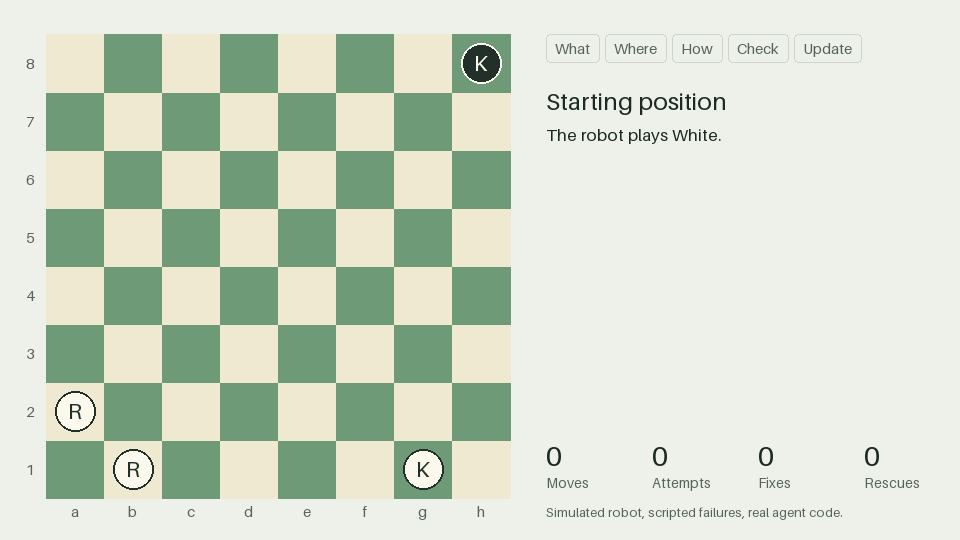

# Dream Chess

YAM bimanual arms play chess using DreamAPI. Dream-1 misses too often to trust blindly, so a
top camera checks every move and the app retries until the board is right.



*This simulation runs the real What, Where, and orchestrator code. The robot and camera are
simulated and the failures are scripted, so it shows the logic, not real-robot accuracy.
Download [docs/simulation.html](docs/simulation.html) and open it in a browser to step through
it yourself.*

- [docs/MISSION.md](docs/MISSION.md): the mission, decisions, where it runs, and how we'll know it works.
- [docs/GAME_PLAN.md](docs/GAME_PLAN.md): who does what and the order to test in.

## How the application works

A chess move looks simple, but a robot can miss the piece, drop it on the wrong square, or bump
a neighbor. Dream-1 moves the arms, but it doesn't choose chess moves or report whether a move
worked. This app supplies both: it decides the move, gives Dream-1 one instruction at a time,
and confirms the result on camera before believing it.

Each turn has five stages:

1. **What: pick the piece.** A chess engine scores every legal move, and each piece takes the
   score of its best move. Among the pieces close to the top score, the app prefers one with
   room around it, so a slightly less sharp move can beat one that risks a collision. It never
   gives up a forced mate for an easier grip.
2. **Where: pick the square and plan the motion.** The engine scores that piece's moves, and the
   app prefers a destination with room around it. It then splits the move into physical steps.
   A capture is two: remove the captured piece, then move yours. Each step gets a plain-English
   prompt and a record of what the board should look like afterward.
3. **How: move the piece.** Dream-1 takes the prompt, the three camera views, and the arm
   positions, then returns motion for the arms. It never says it has finished, so an attempt
   ends when the gripper closes and reopens, or at a time limit. The arms then move out of the
   top camera's view.
4. **Check: read the board.** The top camera compares what it sees with what should be there.
   If they differ, the app works out what's out of place and sends Dream-1 a new prompt to fix
   it. After 6 tries, or if a piece has vanished or many squares look wrong, it asks a person.
5. **Update: record the move.** The app's chess board changes only after every step is
   confirmed, so it can never believe a move happened when it didn't.

The camera then watches for the opponent's move. It only needs to see which squares hold white
or black pieces, because normally just one legal move can produce that pattern. The exception is
promotion, which looks the same for every piece, so the app assumes a queen.

Only How uses a learned model. Everything else is ordinary Python running on the station's
computer, which makes it fast and testable, and unable to invent an illegal move.

## Run it without a robot

```bash
python -m venv .venv
source .venv/bin/activate            # Windows: .venv\Scripts\activate
pip install -r requirements.txt

pytest                               # takes about 3 minutes
python run_game.py                   # full game on the mock robot
python run_game.py --fen "6k1/5ppp/8/8/8/8/5PPP/3R2K1 w - - 0 1"
python vision_tool.py calibrate --synthetic --yes
python vision_tool.py check --synthetic
python visualize.py                  # rebuild the simulation in docs/
```

Games use a weak built-in engine unless you install Stockfish and pass `--stockfish <path>`
or set `STOCKFISH_PATH`.

## How it fits together

| Part | File | Job |
| --- | --- | --- |
| What | `dreamchess/what.py` | Scores every legal move and picks the piece |
| Where | `dreamchess/where.py` | Picks the square, splits the move into steps, and writes the prompts |
| How | `dreamchess/dream_mover.py` | Plays Dream-1's actions on the arms |
| Check | `dreamchess/vision.py` | Reads the board from the top camera |
| Orchestrator | `dreamchess/orchestrator.py` | Runs the loop, retries, and asks a person for help |
| Simulation | `dreamchess/mock.py`, `dreamchess/synth.py` | A failing robot and a simulated camera |
| Visual | `dreamchess/replay.py`, `visualize.py` | Records a real run and builds the GIF and page |

## Status

Tested in simulation only. `dream_mover.py` has only run against a fake client, the camera code
has only seen simulated images, and the Stockfish path has never run.

## Safety

- A person stays at the e-stop whenever the arms can move.
- A person, not a coding agent, runs `python -m dream.check_loop`, `python -m dream.input_check`,
  and `dreamcli tcp`. The Dream docs require this.
- Start new code with `dry_run=True`, which calls the model but never moves the arms.
- Never commit API keys. They belong in `~/.dreamlabs/credentials` on the station.
