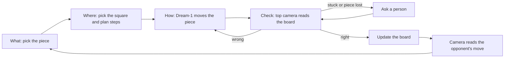
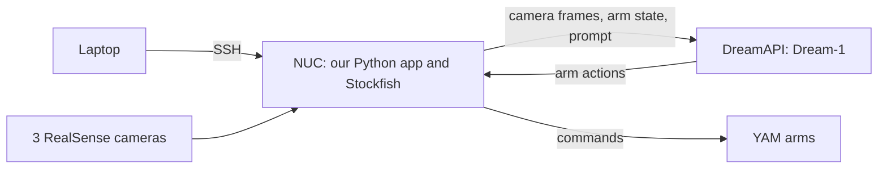

# Mission and decisions

**Mission:** a robot that plays chess delicately, confidently, and accurately, using Dream-1 for
motion and an agent loop that catches and fixes its mistakes.

**The demo:** YAM arms play a short mate-in-2 or mate-in-3 from a sparse position, and recover on
camera from at least one failed grab.

## How one turn works

## Where it runs

There's no frontend. The app is a Python program on the station's NUC, started from a terminal
over SSH.

| Part | Runs on |
| --- | --- |
| What, Where, Check, orchestrator, Stockfish | The NUC |
| Dream-1 | Dream Labs' servers, called over the internet through DreamAPI |
| Arms and cameras | Connected to the NUC |
| Our laptops | Only for SSH, editing code, and running the simulation |

For debugging, Dream's client includes a local debug page, viewable from a laptop over an SSH
tunnel. A small read-only demo screen showing the board and the agent's decisions could help
judges follow along, but build it only after the full loop works.

## Decisions and why

| Decision | Why | Revisit if |
| --- | --- | --- |
| Check every step on camera and retry | Dream Labs reports about 40% full success on pick-and-place, so misses are normal | Never: this is the core of the project |
| What and Where share one set of engine scores | A piece is only as good as its best destination | Never: it follows from the rules of chess |
| Stockfish for chess decisions | It's free, strong, runs on a CPU, and can score every legal move | The NUC can't run it |
| No LLM for chess or safety decisions | Plain code is faster, testable, and can't invent an illegal move | An LLM is optional later for commentary or unusual recoveries |
| Always play Stockfish's move | The robot should play like a strong bot; the rest of the app exists to carry the move out | A margin setting can trade strength for easier moves, but it's off |
| Update the board only after the camera confirms | The program can never believe a move happened when it didn't | Never |
| Depth camera for the check, with color as a fallback | Depth keeps tall pieces on their own square when the camera is at an angle | Depth is too noisy to see pawns |
| Demo a short mate from a sparse board | Sparse boards give the gripper room, and moves could take minutes each | Testing shows full games are practical |
| Ask a person when stuck | A short rescue beats a robot making things worse | Never for lost pieces or a badly disturbed board |

## How we'll know it's working

Passing tests only prove the logic. Each row below needs its own evidence, and the top rows only
show that our code is correct, not that the robot can do this.

| Question | Evidence | Status |
| --- | --- | --- |
| Is the chess and retry logic right? | Tests pass | Passing in simulation |
| Do What and Where work on real Stockfish? | `tests/test_stockfish.py` passes, not skipped | Passed on GitHub ([run](https://github.com/aballal-source/dream-chess/actions/runs/42413389011)); not yet on the NUC |
| Can the camera read the real board? | `vision_tool.py check` gets all 64 squares right | Not run yet |
| Are the model's inputs right? | The dry run's debug page shows correct cameras, state, and prompt | Not run yet |
| Does the control loop work? | A person at the e-stop gets all PASS lines from `check_loop` | Not run yet |
| **Can Dream-1 go to the square we name?** | Out of 10 tries on an empty board, how many land on the right square | **Not run yet: the biggest unknown** |
| Can it work near other pieces? | Out of 10 tries at a pawn with neighbors, how many avoid disturbing them | Not run yet |
| Does the whole thing work? | The demo game finishes three times with the board correct | Not run yet |

Log every try: prompt, position, result, attempts, and time per attempt.

## How we'll know we're on the right path

The design fits what we know about Dream-1, but it rests on an untested assumption: that a text
prompt can direct it to a specific square accurately enough. Test that before building anything
else on top. These are proposed starting targets, to adjust as we learn:

| After 10 tries on an empty board | Then |
| --- | --- |
| At least 5 land on the right square | On track: move to the crowded pawn test |
| 2 to 4 land on the right square | Try other prompts, then large labels on the squares |
| 0 or 1, even after those changes | Change the demo: fewer squares, bigger pieces, or fine-tuning if there's time left |

Other signals to act on:

- **The camera can't read pawns:** use color-only mode and a straighter camera angle.
- **Crowded pieces keep getting knocked over:** make the demo position sparser.
- **Each move takes too long to demo live:** shorten the game and speed up the video, saying so.
- **Rescues happen on most moves:** reduce the demo until one clean run is possible.

A partly working robot that visibly notices its mistake and fixes it is still a strong demo,
because that recovery is what this project adds to Dream-1.
